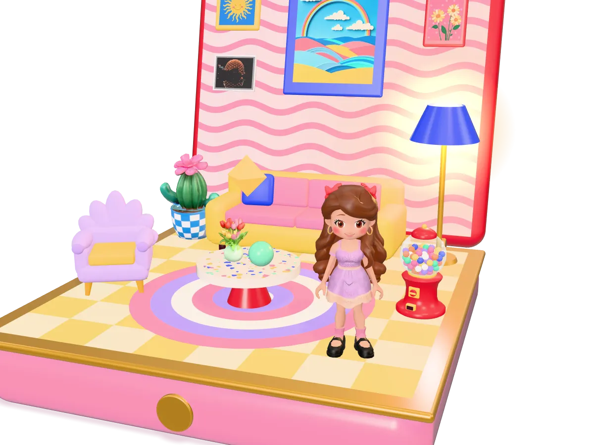

# Popfold

> **Status: alpha (0.51.0).** Everything here is experimental and changes often. Backwards compatibility is **not**
> required (APIs, recipes, piece keys, file formats, folder layout) until a version **1.0.0 or later is tagged**.
> Until then, expect breaking changes in any commit and don't depend on anything staying put.

Scroll-driven 3D "pocket homes" for the web: a home that unfolds as the visitor scrolls (a compact whose lid and
drawers open into three rooms, a modelled room whose walls fold up, a tower whose floors light up one by one, or a
pop-up book whose pages turn), with furniture that springs or folds in, a camera that follows the story, clickable
stories on pieces, links between sections and homes, pages in more than one language, and an optional guide figure.
A home is a JSON file that Popfold Studio edits. Built on three.js; installed from npm by Vite sites, or on any page
through `<popfold-home>`.

```
pnpm dlx @popfold/engine init my-site --template storybook   # or compact, tower, diorama
cd my-site && pnpm install && pnpm dev
```

Guides (how it works, building a site, making models, working on it as an agent) are in `docs/`; start at
`docs/README.md`. This page is the API reference.

## Made with Popfold

[](docs/showcase.md)

**Dopamine Spaces**, Popfold's first site: https://dopamine.popfold.ca. Demos with their source: a résumé as a
tower (https://todorov.ca), a pop-up storybook (https://storybook.popfold.ca), and popfold.ca itself. All of them
are in [docs/showcase.md](docs/showcase.md).

## Use it in a site

```ts
import { startScene, createStoryCard, type HomeRecipe } from 'popfold';

const scene = await startScene({
  canvas,                       // a full-window <canvas>
  homes: [myHome],              // HomeRecipe[]: every home the page can show
  home: 'my-home',              // the one to show first
  beats: BEATS,                 // the story, one beat per page section: from homeFromFile(json, { kinds }), or beat('section-id', 'Name', values, camera, lookAt)
  getStage: scrollStage(),      // where the story is, from the scroll position (from 'popfold/fallback')
  reducedMotion,
  avatar: false,                // or { url: 'models/figure.glb' } for a rigged guide (the built-in figure is the fallback)
  // lighting: { day: { sky: '#F4F6FA' }, shadow: '#334455' },   // the site's own light (optional)
  // storyDot: '#2F6BFF',         // the colour of the dots on pieces with a story
  // base: '../',                 // only for a page popfoldFallback() does not list: where the site's models are from here
  onStory: (story, key, x, y) => card.open(story, x, y), // with const card = createStoryCard()
  onPick: (part) => {},         // a click on 'center' | 'left' | 'right'
});
scene.setHome('other-home');    // swap homes; also flags, override, setOrbit, setLighting, snapshot... for tools
scene.dispose();                // stop it for good and free the GPU (single-page apps, tests)
```

`templates/compact` (an office in a box), `templates/tower` (a four-floor building) and `templates/diorama` (a
modelled room whose walls unfold) are complete, short sites to copy: `node bin/popfold.mjs init <folder>
[--template tower|diorama]` starts a new site from one.

## Without a build step: `<popfold-home>`

A page that is not built with Vite (any page, any host) can show a home from its JSON file. Take the library bundle,
the whole `dist/` folder that `pnpm build:lib` writes (`popfold.js`, the `.js` files beside it and `cases/`), and
put the home file and its models beside the page:

```html
<script type="module" src="lib/popfold.js"></script>
<popfold-home src="room/home.json" style="height: 80vh"></popfold-home>
```

The story follows the element through the viewport, from its first beat as it comes in to its last as it leaves;
`stage="2"` holds it on one beat instead. Models load from the home file's folder (`base` for another). Other
attributes: `light="evening"`, `guide` (the guide figure), `ambient="off"` (no decoration, nothing drawn at rest) and
`side` (keep the beats' sideways shift, which leaves room for a page's text). Clicking a story's dot opens its card.

Pieces whose kind is a model file need nothing more. Kinds built in code, and a diorama's painted art, come from a
script, which uses the bundle's own three.js:

```html
<script type="module">
  import { PopfoldHome, THREE } from './lib/popfold.js';
  PopfoldHome.code = { diorama: { art: { art_board: () => new THREE.CanvasTexture(myCanvas) } } };
</script>
```

The element's `scene` is the same scene `startScene()` returns, and it fires `popfold-ready` (and `popfold-error`).
The bundle is about 1.1 MB (270 KB gzipped) with three.js inside; everything else Popfold exports is in it too.

## Popfold Studio on a site

Add a `studio.html` page that loads a script calling `mountStudio()` from `popfold/studio` with the site's homes
and beats (see `templates/compact/src/studio.ts`), list it in the Vite build inputs, and add
`homeSaver({ home: 'src/home.json' })` from `popfold/vite` to the Vite plugins so *Save* can write every change
back into the home file on the local dev server (a home made in code cannot be saved from the studio). Unsaved changes are kept per home as a draft in the browser's localStorage and offered back after a
reload.

## Without 3D: the simple page

Every Popfold site works without WebGL, without JavaScript and for crawlers and AI agents. The page starts as the
simple version and only upgrades to 3D once the scene is running.

- **Build time:** `popfoldFallback({ siteName, homeFile, sections, jsonLd, siteUrl })` from `popfold/vite` (for a
  home kept in code: `stories` and `stillsHome` in place of `homeFile`)
  writes each story under its section (`<div class="pf-stories">`), puts a still beside every stage section
  (`public/stills/<home>-<n>.webp`, n = keyframe), adds the fallback CSS, JSON-LD, `og:image` and `canonical`
  (with `siteUrl`), and emits `llms.txt`, `robots.txt` and `sitemap.xml` (with `siteUrl`).
- **In the browser:** `popfold/fallback`: `shouldStart3D()` (WebGL present; not `?view=simple`, a saved
  "simple" choice, Save-Data or a very low-memory device), `markReady(canvas)` after `startScene` (sets
  `html.has-3d`, falls back if the GPU context is lost), `markFallback()`, and `viewToggle()` for the
  "Simple view / 3D view" button.
- **Stills:** in a site's studio (dev server), **Capture stills** steps through every story stop and saves one
  WebP per stop. Recapture after changing a home or its camera path. A home no page shows (one only the studio
  has) keeps its stills in `stills/` at the site's root instead of `public/stills/`, so no build carries them.
- **From a script:** run `popfold build` in a site's folder (each site has `pnpm build:static`). It captures
  fresh stills headlessly and then runs `vite build`. `popfold build --keep` builds with the stills already
  there, and `popfold stills` only captures them. Captures are repeatable, and a still that looks the same as
  before is put back untouched, so git shows only the stills that really changed. `popfold stills --check`
  changes nothing and fails if any still differs: a visual test. `popfold check` reports mistakes (lists that do
  not line up, stories and places that match no piece, models that did not load), `popfold describe`
  prints every home as JSON, and `popfold shot` saves a picture of any view. They all read the home from `popfoldFallback()`, so
  there is nothing extra to configure. It needs a local Chrome or Edge (or `POPFOLD_BROWSER=<path to Chromium>`)
  and the optional `playwright-core` package. It uses the GPU when there is one, about 20 s a site; without one it
  draws in software, which takes minutes.
  Every page has a debug panel, opened with the Debug button beside *Simple view*, `?debug` in the address or
  Alt+Shift+D: the build's versions and live
  numbers on how the page is running (`debug: false` takes it away; see `docs/guide.md`).
  `popfold optimize` makes the models in `public/models` smaller (usually 40 to 65%) without changing how they
  look or moving anything in them (`--simplify` also takes triangles away, and is lossy); `popfold split-room` cuts
  a diorama's room model in two so the room shows first; see `docs/models.md`. `popfold mcp` offers the studio's
  edits and these checks to an AI agent, through the running dev server (`docs/agent-tools.md`).

`?view=simple` or `?view=3d` in the address forces a mode for testing.

A site with several story pages lists them: `popfoldFallback({ siteName, siteUrl, pages: [{ html, stories,
sections, stillsHome }, …] })`. A page with `from: 'index.html'` is made from that page's HTML, for one address per
home; with `lang` and `text` (a translation file), it is that page in another language. In the browser, `t(words)`
is the page's translation of `words` and `pageLang()` its language. See "More than one story page" in
`docs/guide.md`.

## A home: `HomeRecipe`

The templates keep a home in a JSON file and make the recipe from it: `const { recipe, beats } =
homeFromFile(json, { kinds })` (see `docs/create-a-site.md`). The same recipe written out in code:

```ts
const myHome: HomeRecipe = {
  id: 'my-home', name: 'My home', blurb: '…', swatch: ['#…', '#…', '#…', '#…'],
  look: { base, lid, heart, leftSlab, rightSlab, centerFloor: () => tex.checker(…), lidPaper, leftFloor, leftWall, rightFloor, rightWall },
  pieces: [                                   // what is in the home: floor pieces at [x, z], wall pieces at [x, height]
    { id: 'sofa', room: 'center', kind: 'sofa', at: [0, -1.3], story: { title: '…', text: '…', tags: ['…'] } },
    { id: 'reading-lamp', room: 'left', kind: 'lamp', size: 1.2, at: [1.5, -1.3] },          // a model file
    { id: 'print', room: 'right', wall: true, kind: 'print', at: [1.4, 1.5] },
  ],
  kinds: {                                    // how to build each kind that is not a model file
    sofa: () => P.sofa(),
    print: () => P.pictureFrame(0.6, 0.6, tex.blobArt(…), '#fff'),
  },
  props: ['lamp'], propDir: 'models/props',   // model files: <propDir>/<name>.glb, longest side = 1, front +Z
  emblem: { title: 'my', subtitle: 'home' },
  // rooms: { center: 'living', left: 'closet', right: 'dream' },   // your own room names in keys
  fold: 'compact',                            // or 'book'
};
```

A piece's key is `<room>/<id>` (`<room>-wall/<id>` on a wall). Other fields of a piece: `turn`, `lift`, `out`,
`delay`, `lamp` and `opts` (see `PieceSpec` in `types.ts`). For what a list cannot say, a recipe can also have
`furnish(ctx)`, which places pieces in code after the listed ones.

In `furnish(ctx)`: rooms are 4 units wide; side-room walls are 2.2 tall. Floor pieces sit at `y0` (centre) or `fy` (side rooms); wall
pieces go on `left.wall` / `right.wall` at z ≈ 0.14; the open lid is the centre room's back wall (add with
`rotation.x = PI/2`, `y = -0.04`, `z` = height). `pop(list, obj, delay)` makes a piece spring in with its room.
`ctx.setLamp({ group, bulb })` names the lamp whose glow the story controls. Built-in pieces are in `P` (they tag
themselves for their keys), colours in `C`, canvas textures in `tex`.

## Places and stories

Every popped piece gets a key. `piece(obj, 'reading-lamp')` gives a piece its own id and the key `<room>/<id>`,
which stays put when pieces are added around it; without an id the key is `<room>/<prop>` (`#2`… for repeats, in
the order the code adds them). In a diorama's model, a custom property `id` on a piece does the same. A compact's rooms are `center`, `left` and
`right` unless the recipe names them (`rooms`), with `-wall` for wall pieces; a diorama's are its zones; a tower's
are its floor ids. A home file's `places` (a home made in code may set `recipe.places`) moves,
turns, resizes or hides pieces by key (`layout.ts`); Popfold Studio writes them. A listed piece's `story` puts a dot on it and opens a story card; `recipe.stories` does the same
by key for pieces placed in code.

## Files

| File | |
|---|---|
| `engine.ts` | `startScene()`: renderer, lights, story playback, folds, guide figure, picking, studio hooks |
| `compact.ts`, `diorama.ts`, `tower.ts`, `book.ts` | the four shells' builders (`shells.ts` registers them; `shell.ts` is the interface); `popup.ts` holds the book's pop-ups |
| `pieces.ts`, `home-file.ts` | `readHome()` checks a home file; `homeFromFile()` makes the home and its story from it |
| `transitions.ts` | links between sections and homes, and the doors that carry them |
| `types.ts` | `HomeRecipe`, `Look`, `FurnishContext`, `PropStory` |
| `keyframes.ts` | story fields, `beat()`, a beat as data (`beatsOf()`), `keyframe()`, `sample()` |
| `layout.ts`, `hotspots.ts`, `story-card.ts` | piece keys and places, story dots, the story card |
| `studio/` | Popfold Studio (`mountStudio`), its props inspector and styles |
| `vite-plugin.ts` | `homeSaver()` (the dev-server endpoints the studio saves through: the home file's command list, stills) and `popfoldFallback()` (the page without 3D) |
| `element.ts`, `lib.ts` | `<popfold-home>` and the library bundle's entry (`pnpm build:lib`) |
| `props.ts`, `textures.ts`, `effects.ts`, `avatar.ts` | built-in pieces, canvas textures, sparkles, the built-in guide figure |

## Making it look like your site

Nothing in Popfold carries a brand. A site sets its own:

| What | How |
|---|---|
| Light and the ground shadow | `startScene({ lighting })` |
| Story dots | `startScene({ storyDot: '#…' })` |
| The story card | CSS variables on `:root`: `--pf-card-bg`, `--pf-card-ink`, `--pf-card-accent`, `--pf-card-tag`, `--pf-card-focus`, `--pf-card-font`, `--pf-card-display` |
| A compact's step badges | `look.badges` (three `[background, number]` pairs) and `look.badgeRing` |
| The built-in pieces and the guide figure | `setPalette({ pink, cherry, wine, butter, cobalt, mint, lilac, white, gold, orange, green })` before `startScene()`; names left out keep the default |
| The case's fittings and drawer walls | `look.trim` (hinges, the clasp's ring) and `look.drawerWall` |
| Parts from different cases | `look.parts`: `{ "lid": "crisp" }`, any of base, lid, drawers, walls, clasp and heart |
| The compact's case | `look.shell`: `'round'` (default), `'crisp'`, `'code'` (with `look.corner`, 0 sharp to 1 soft) or `{ url }` for your own model |
| A heart on a compact's lid | `emblem: { heart: true }` adds it (off by default) |
| The studio's panel | `mountStudio({ theme: { accent: '#…', ink: '#…', paper: '#…' } })` |

Pass `lighting`, `storyDot`, `base` and `transitions` to `mountStudio()` as well, so the studio and its stills match the site
and its doors show there. A home's time of day is its own `mood` (`"mood": "evening"` in its file), which the site,
the studio and the stills all take.

## Releases

Popfold is on npm as `@popfold/engine`. A site installs it under the name `popfold` (`"popfold":
"npm:@popfold/engine@0.50.0"`), and moves to a newer release with `pnpm exec popfold update [version]`. `pnpm release <version>` cuts a release here. Both are described in
`docs/releasing.md`; `CHANGELOG.md` says what each release changed.

## Credits

Created by **Dimiter Todorov**. Creative direction: **Alyssa Jacoby** (Dopamine Spaces).
Built with **Claude Code** (Anthropic). Every library, tool and AI model used is in [CREDITS.md](CREDITS.md).


The props and art of the sites above were made with **[the forge](https://github.com/popfold/forge)**, Popfold's
open-source model pipeline: a picture from FLUX or Chroma, a mesh from TRELLIS.2 or Hunyuan3D, Blender to finish it,
all on one local GPU.

## License

MIT (see `LICENSE`), copyright Dimiter Todorov.
