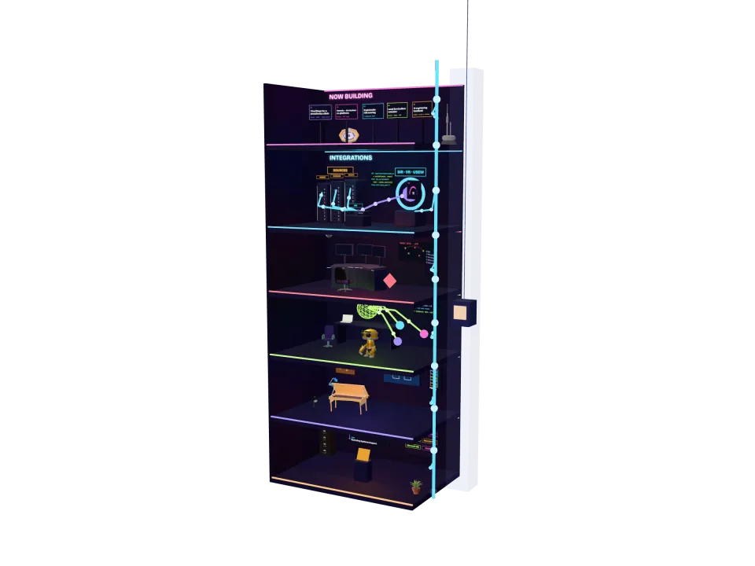

# Made with Popfold

A site built on Popfold, shown with the owner's permission, with what each part of it uses. The pictures are
the site's own stills: the ones its page without 3D shows.

## Dimiter Todorov: a résumé as a building

**https://dimiter.popfold.ca** · a tower home

A résumé told as a building: one neon floor per skill set, and an integration pipeline running down the building's
spine. Scrolling the page rides up the tower floor by floor, each floor opening and lighting up as its section of
the page comes into view.



| | |
|---|---|
|  |  |
| The Integrations floor: its sources feeding a pipeline | The AI floor, one floor up |

What it is made of:

- **The tower shell**, with six floors in its home file (`floors`): Now building, Integrations, Threat intel, AI,
  Design and Foundations. Each floor has a section of the page and a beat of the story, so the page and the
  building stay in step.
- **Pieces listed in the home file** (48 of them), each with its floor as its room, and 24 stories (kept by key in
  the site's `src/stories.ts`): a click on a dot opens the story card beside the piece.
- **Glowing pipes** (`Flow`) along the building's spine and into each floor, brighter as each floor lights up.
- **The page without 3D**, built from the same file by `popfoldFallback()`: every section with its still and its
  stories written out, for search engines, screen readers and visitors without WebGL.

Started from the tower template (`popfold init --template tower`), which shows the same shape in a smaller
building.

## Show that a site is made with Popfold

A site made with Popfold may wear a badge, linking to popfold.ca. Three designs, each in a light and a dark version,
are in `assets/badges/` (drawn by `tools/badges.mjs`):

| | Light | Dark |
|---|---|---|
| A heart |  |  |
| A folded corner |  |  |
| The mark alone |  |  |

On a page, with the dark version when the reader's system is dark (the files come with the package, so a site can
also copy them from `node_modules/popfold/assets/badges/` into `public/`):

```html
<a href="https://popfold.ca" class="made-with-popfold">
  <picture>
    <source media="(prefers-color-scheme: dark)" srcset="https://unpkg.com/@popfold/engine/assets/badges/made-with-popfold-heart-dark.svg" />
    
  </picture>
</a>
```

In a README:

```md
[](https://popfold.ca)
```

The mark alone is 44 by 44, for a corner of a page; swap `heart` for `fold` or `mark` in the file names.
